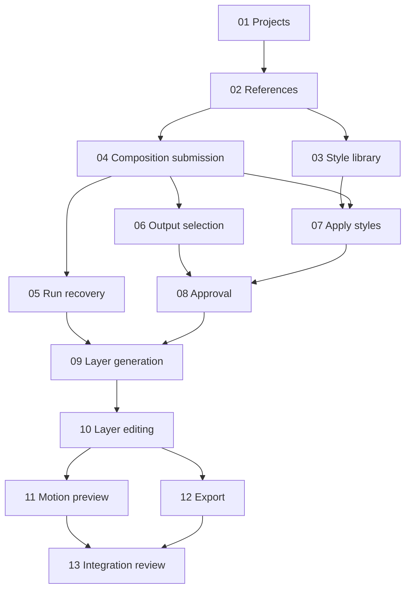

# Gas City preparation for the asset workflow

Date: 2026-11-05 Revision: 4. Published as held Beads backlog. See [the ticket index](tickets.md) for real IDs.

Status: Documentation and backlog setup complete. Epic `ps-cdek` and sixteen children are blocked and unassigned. No implementation, dispatch, branch creation, or paid generation has started.

The [product spec](../../specs/asset-workflow.md) owns scope. The destination remains the existing personal-site app and shared UI package. [Engineering evidence](engineering-evidence.md) governs brain, lore, and Effect source lookup.

## Early landing lane

The [early landing plan](landing-first.md) adds three separate prerequisite diffs: approved workflow documentation, a deterministic reference fixture, and qualification/addition of the selected canvas dependency.

These can land before the feature is complete. AW-01 and AW-02 follow as the first usable product stack. Existing Effect, XState, AI SDK, Eve, motion, and shared UI dependencies are reused.

PRE-03 gates AW-01 only if the chosen canvas implementation requires the new dependency. PRE-01 is a dispatch-readiness condition. PRE-02 is test support rather than an artificial code blocker.

## Smaller implementation diffs

Twelve implementation diffs and one final verification gate replace the original eight tickets. Each diff delivers a usable behavior with its own checks. No separate schema-only, API-only, or test-only implementation tickets are added.

| Ticket | Deliverable | Required behavior dependencies |
| --- | --- | --- |
| [AW-01](issues/01-projects.md) | Local project workspace | PRE-03 if a new canvas dependency is selected |
| [AW-02](issues/02-references.md) | Upload and reuse project references | AW-01 |
| [AW-03](issues/03-style-library.md) | Save reusable style revisions | AW-02 |
| [AW-04](issues/04-composition-submit.md) | Generate a composition safely | AW-02 |
| [AW-05](issues/05-run-recovery.md) | Resume observation and recover downloads | AW-04 |
| [AW-06](issues/06-output-selection.md) | Compare history and select an output | AW-04 |
| [AW-07](issues/07-style-application.md) | Generate with a selected style revision | AW-03, AW-04 |
| [AW-08](issues/08-approval.md) | Approve an exact composition revision | AW-06, AW-07 |
| [AW-09](issues/09-layer-generation.md) | Prepare and inspect transparent layers | AW-05, AW-08 |
| [AW-10](issues/10-layer-editing.md) | Save layer presentation edits | AW-09 |
| [AW-11](issues/11-motion-preview.md) | Preview parallax and maximum offsets | AW-10 |
| [AW-12](issues/12-portable-export.md) | Export a portable asset bundle | AW-10 |
| [AW-13](issues/13-integration-review.md) | Prove the complete workflow | AW-11, AW-12 |

## Parallel work

There are three useful parallel groups:

- After AW-02, the style library and composition submission can proceed independently.
- After AW-04, run recovery and output selection can proceed independently. Style application also becomes ready once AW-03 is complete.
- After AW-10, preview and export can proceed independently.

The graph represents behavior dependencies, not Graphite branch ancestry. The [stack workflow](stack-workflow.md) defines how independent work becomes reviewable stacked diffs without pretending a branch has multiple parents.

## Contracts frozen at split points

| Producer | Contract established in its working slice | Consumers |
| --- | --- | --- |
| AW-01 | Project identity, revision-checked writes, route/panel mount points | All later work |
| AW-02 | Asset references and input revision semantics | AW-03, AW-04 |
| AW-03 | Immutable style revision lookup | AW-07 |
| AW-04 | Immutable run snapshots, safe submission, history reads, recovery extension | AW-05, AW-06, AW-07 |
| AW-06 and AW-07 | Selection identity and complete generation input revision | AW-08 |
| AW-08 | Server-side approval assertion | AW-09 |
| AW-09 | Layer placement and revision-aware presentation interface | AW-10 |
| AW-10 | Coherent presentation snapshot and explicit motion units | AW-11, AW-12 |

These interfaces are defined as part of the first real behavior that needs them. They do not justify a preliminary framework or general-purpose provider abstraction.

A producer publishes the contract and checked revision before dependent workers start. A contract change after the split pauses affected consumers until the coordinator updates the base and assignments.

## Safety is present in the first usable diff

AW-04 already persists submission identity, immutable inputs, and accepted or unknown states. Duplicate paid submissions are prevented there. AW-05 adds reconciliation and download recovery; it does not repair an intentionally unsafe first version.

Every new endpoint inherits local-only availability, origin checks, validated inputs, and constrained file access. These checks cannot wait until the final ticket.

## Requirement coverage

Numbers refer to the product spec's acceptance criteria.

| Criterion                             | Owning tickets                    |
| ------------------------------------- | --------------------------------- |
| 1. Persistent project and inputs      | AW-01, AW-02, AW-03, AW-07        |
| 2. Generation and preserved history   | AW-04, AW-05, AW-06               |
| 3. Approval and stale results         | AW-06, AW-07, AW-08, AW-09        |
| 4. Immutable style and run snapshots  | AW-03, AW-04, AW-07               |
| 5. Inspectable layers and placement   | AW-09                             |
| 6. Saved presentation and export      | AW-10, AW-12                      |
| 7. Reduced motion and maximum offsets | AW-11                             |
| 8. Offline reconstruction             | AW-12                             |
| 9. No automatic duplicate paid jobs   | AW-04, AW-05, AW-09               |
| 10. Local access and unchanged blog   | AW-01, all endpoint owners, AW-13 |

## Mapping from the previous draft

| Previous draft                 | Revised tickets     |
| ------------------------------ | ------------------- |
| AW-01 Projects and references  | AW-01, AW-02        |
| AW-02 Reusable styles          | AW-03, AW-07        |
| AW-03 Generation and history   | AW-04, AW-05, AW-06 |
| AW-04 Approval                 | AW-08               |
| AW-05 Layers                   | AW-09               |
| AW-06 Preview and presentation | AW-10, AW-11        |
| AW-07 Export                   | AW-12               |
| AW-08 Verification             | AW-13               |

## Shared assignment contract

Each worker receives the spec, its ticket, engineering evidence, approved decisions, exact dependency revisions, and exclusive file ownership. Workers are not alone in the codebase and preserve unrelated edits.

Ownership in the tickets names modules and responsibilities. The coordinator resolves these to concrete files against the current checkout before dispatch. Parallel workers never share a mutable worktree.

Shared schemas, page composition, package manifests, lockfiles, and Graphite metadata have one writer. Workers can produce focused integration patches, but the coordinator applies shared-page wiring serially. The coordinator does not grant parallel workers broad ownership of the entire feature directory.

Each ticket reports source identities, source behavior, the decision made, changed files, relevant check results, review findings, and limitations. Pattern IDs alone are not source evidence.

Each implementation diff receives independent review. Substantial or sensitive changes require the prescribed correctness, security, and complexity reviews. All reviewers use the same stable patch and perform independent source lookup. Restacked descendants rerun affected checks before their verdict is reused.

## Gas City intake boundary

The [proposed Beads tracker adapter](gas-city-tracker.md) defines the epic, sixteen child issues, native blocking links, held publication, and the separate execution boundary. The tracker configuration is installed under `docs/agents/`; the backlog is published and held. See [the verified receipt](beads-receipt.json).

The existing city and rig remain `personal-site-city` and `personal-site`. The inspected role pack is pinned at `3b3b89f2011e06d84459aa7bea1552382f13930a`.

Gas City provides planning, decomposition, implementation, and review continuations. Its executing formulas do not become planning-only by setting `review_mode=report` or an artifact status of `draft`.

The inspected worktree path starts individual work at detached HEAD; the shared implementation drain explicitly runs one item at a time. Neither proves automatic Graphite parent selection, restacking, or per-ticket PR publication. The coordinator policy in the stack workflow must be implemented or explicitly operated before dispatch.

The Matt skills' custom tracker documentation is installed for Gas City Beads. Published issues are ordinary held backlog issues, not live workflow artifacts. No workflow IDs or readiness labels were added.

The user approved setup and held ticket publication. Separately authorize implementation before dispatch. Existing dependency and skill-update queues remain untouched.
